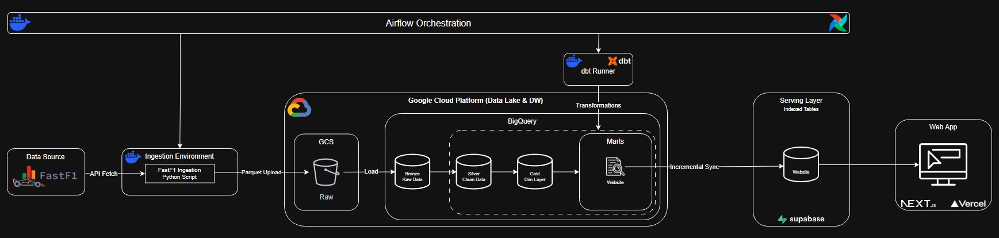

# Formula 1 Data Pipeline

[-E10600?style=for-the-badge&logo=vercel&logoColor=white)](https://f1-pitwall-hub.vercel.app)

Este projeto implementa um pipeline de dados ponta a ponta (*end-to-end*) focado na ingestão, estruturação, modelagem analítica e visualização de dados históricos e recentes da **Fórmula 1** (desde 1950 até a temporada atual).

> 🌐 **Acesse a plataforma ao vivo:** **[f1-pitwall-hub.vercel.app](https://f1-pitwall-hub.vercel.app)**

O pipeline foi desenhado para operar de forma **incremental e automatizada**. À medida que o campeonato avança e novas sessões de Grandes Prêmios acontecem, o fluxo detecta, extrai, transforma e sincroniza apenas os novos dados, mantendo toda a plataforma atualizada.

O objetivo é disponibilizar dados estruturados de alta performance para análise e visualização de:
- 🏎️ **Métricas de Corrida & Temporada**: Posições finais, pontos acumulados, classificação oficial (respeitando regras históricas da FIA) e matriz completa da temporada estilo Wikipedia.
- 👤 **Perfis & Histórico dos Pilotos**: Raio-X de carreira, títulos mundiais, rankings *all-time*, taxa de conversão de poles, vitórias por circuito e evolução temporada a temporada.
- 🛡️ **Perfis & Histórico das Escuderias**: Trajetória histórica dos construtores, títulos mundiais, dobradinhas (1-2), primeiras filas, pódios e pontos duplos, rankings *all-time* e elenco de pilotos por temporada.
- 🏟️ **Perfis & Histórico dos Circuitos**: Ficha técnica das pistas, recordes de volta, histórico de corridas, maiores vencedores (pilotos e construtores) e distribuição de vitórias por posição no grid.
- ⏱️ **Desempenho em Pista & Telemetria**: Tempos de volta (*lap times*), ritmo de corrida (*race pace*), estratégias de pneus (*stints*), voltas ideais e velocidades máximas (*Speed Trap*).
- 📅 **Calendário Dinâmico**: Cronograma completo e acompanhamento em tempo real de todas as sessões (Treinos Livres, Qualificações, Sprint e Corrida).

## 🛠️ Tecnologias Utilizadas

O projeto combina uma arquitetura moderna de **Cloud Data Warehouse (OLAP)** com uma **Serving Layer Relacional (OLTP)**:

*  **Orquestração** — Agendamento incremental, detecção de sessões pendentes e gerenciamento de containers isolados.
*  **Ingestão & Sincronização** — Extração via biblioteca [FastF1](https://github.com/theOehrly/Fast-F1), serialização em memória com `pandas`/`pyarrow` (Parquet) e sincronização incremental via protocolo `COPY`.
*  **Data Lake & Data Warehouse (GCS & BigQuery)** — **Google Cloud Storage** para armazenamento imutável de arquivos brutos (`.parquet`) e **Google BigQuery** como Data Warehouse analítico para as camadas *Bronze*, *Silver*, *Gold* e *Marts*.
*  **Transformação** — Modelagem dimensional (*Snowflake Schema*), regras de negócio históricas e testes automatizados de qualidade de dados no BigQuery.
*  **Serving Layer (PostgreSQL)** — Banco de dados relacional contendo as tabelas analíticas materializadas e indexadas (B-Tree) para consultas de baixíssima latência pela aplicação web.
*  /  /  **Web App & Visualização** — Interface web interativa ([**Pitwall**](https://f1-pitwall-hub.vercel.app)) desenvolvida em Next.js e hospedada na Vercel.
*  /  **Ambiente & Infraestrutura** — Containerização completa garantindo reprodutibilidade e isolamento entre orquestrador, ingestão, `dbt` e front-end.

## 🏛️ Arquitetura do Projeto

O pipeline segue o modelo **ELT (Extract, Load, Transform)** aliado a uma camada dedicada de **Serving**, totalmente orquestrado para processar novas sessões e atualizar o dashboard automaticamente.

### Componentes e Fluxo dos Dados

1. **Orquestração (`Apache Airflow`)**:
   - Gerencia o ciclo de vida completo do pipeline.
   - A cada execução, consulta o calendário e o estado das tabelas no BigQuery para identificar sessões já encerradas que ainda não foram processadas, disparando dinamicamente containers Docker para ingestão, transformação (`dbt`) e sincronização.

2. **Extração & Ingestão (`FastF1` & `Ingestion Environment`)**:
   - Um container Python isolado consome a API do **FastF1** (`API Fetch`) para coletar resultados, tempos de volta e telemetria das sessões pendentes, convertendo os dados diretamente em memória para o formato colunar **Parquet**.

3. **Data Lake & Carga Bruta (`Google Cloud Storage` & `BigQuery Bronze`)**:
   - **GCS (`Raw`)**: Os arquivos Parquet são enviados ao bucket no **Google Cloud Storage** (`Parquet Upload`), atuando como *Data Lake* imutável e versionado.
   - **BigQuery (`Bronze Raw Data`)**: A partir do GCS, um *Load Job* carrega os dados brutos para as tabelas nativas da camada 🥉 **Bronze** no BigQuery.

4. **Transformação Medalhão no Data Warehouse (`BigQuery` & `dbt Runner`)**:
   - O container `dbt Runner` executa as transformações analíticas e testes de qualidade dentro do **BigQuery**:
     - 🥈 **Silver (`Clean Data`)**: Higienização, deduplicação, padronização de identificadores e conversão de tipos.
     - 🥇 **Gold (`Dim Layer`)**: Modelagem dimensional *Snowflake* composta por tabelas de fatos e dimensões particionadas e clusterizadas.
     - 📊 **Marts (`Website`)**: Views analíticas pré-agregadas por domínio de negócio (temporadas, pilotos, escuderias, circuitos e telemetria).

5. **Serving Layer (`Supabase PostgreSQL`)**:
   - Um processo de **Incremental Sync** extrai apenas as partições/temporadas atualizadas dos *Marts* do BigQuery e realiza carga em lote via protocolo nativo `COPY FROM STDIN` para o **Supabase (PostgreSQL)**.
   - No Supabase, os marts residem como **Tabelas Físicas Indexadas (`Indexed Tables`)**, garantindo respostas em milissegundos para o front-end sem gerar custos de varredura por requisição no BigQuery.

6. **Consumo & Visualização (`Web App` — `Next.js` & `Vercel`)**:
   - Aplicação web moderna que consome a *Serving Layer* do Supabase com cache otimizado para entregar dashboards interativos de corridas, telemetria, matrizes de campeonato e enciclopédia histórica de pilotos, equipes e circuitos.

## 📚 Documentação do Projeto

Para instruções detalhadas de configuração, arquitetura e modelagem, consulte os guias dedicados:

- 🚀 **[Guia de Setup e Execução Local](docs/setup.md)**: Pré-requisitos, configuração das credenciais do GCP e Supabase, inicialização dos containers Docker, Airflow e comandos do dia a dia.
- 🏛️ **[Detalhes da Arquitetura](docs/architecture_details.md)**: Decisões de engenharia, especificidades do fluxo ELT, orquestração e sincronização incremental da *Serving Layer*.
- 📊 **[Modelagem de Dados](docs/data_modeling.md)**: Arquitetura Medalhão no BigQuery, modelo dimensional *Snowflake*, dicionário das tabelas e regras das views analíticas.
