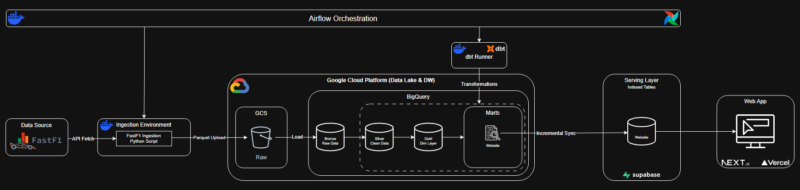
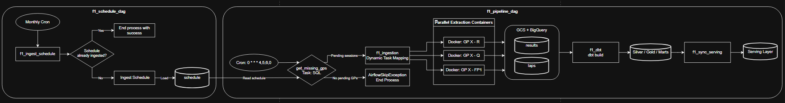

# 🏛️ Detalhes da Arquitetura & Decisões de Engenharia

Este documento descreve os componentes técnicos, padrões de engenharia e decisões de design adotadas no **Formula 1 Data Pipeline**.

---

## 🎯 1. Visão Geral

O projeto combina uma arquitetura moderna de **Cloud Data Lake & Data Warehouse (OLAP)** no **Google Cloud Platform** com uma **Serving Layer Relacional (OLTP)** no **Supabase (PostgreSQL)**, estruturada em quatro pilares principais:

- **Extração & Data Lake**: Ingestão via Python/FastF1 persistindo os arquivos brutos (`.parquet`) no **Google Cloud Storage (GCS)** e carregando a camada `bronze` no **Google BigQuery**.
- **Transformação & Data Warehouse**: Modelagem dimensional (*Snowflake Schema*), aplicação de regras históricas da FIA e testes de qualidade executados pelo **dbt** dentro do **BigQuery** (`silver` → `gold` → `website`).
- **Serving Layer Incremental**: Sincronização otimizada (`COPY FROM STDIN`) dos *Marts* do BigQuery para tabelas físicas indexadas no **PostgreSQL (Supabase)** para consumo em milissegundos pelo front-end.
- **Orquestração**: Agendamento incremental, detecção inteligente de sessões pendentes e paralelismo gerenciados pelo **Apache Airflow 3**.



---

## 🏗️ 2. Componentes & Decisões Técnicas

### 2.1 Ingestão & Extração (Python + FastF1)
- **Biblioteca FastF1**: Extração de resultados oficiais, tempos de volta (*laps*), setores, estratégias de pneus, velocidades máximas (*Speed Trap*) e calendário oficial da temporada.
- **Buffer em Memória (`io.BytesIO`)**: Os DataFrames extraídos são serializados para Parquet diretamente em memória antes do upload para o GCS, evitando I/O de arquivos temporários em disco nos containers.
- **Cache Local (`fastf1_cache`)**: Volume Docker persistente compartilhado entre as tarefas de ingestão para reaproveitar downloads da API da F1 e acelerar reprocessamentos.
- **Verificação Dupla de Existência e Tolerância a Atrasos da API**:
  - Antes de iniciar uma extração, o orquestrador valida se a sessão já existe **tanto no bucket GCS quanto nas tabelas `bronze.results` e `bronze.laps` do BigQuery**.
  - Caso a sessão tenha acabado de ocorrer e a API disponibilize primeiro a classificação (`results`) enquanto a telemetria de voltas (`laps`) ainda está em processamento pós-corrida, o pipeline persiste imediatamente os resultados disponíveis e reprocessa automaticamente as voltas na janela seguinte.

### 2.2 Data Lake Raw (Google Cloud Storage — GCS)
- **Armazenamento Objeto (`GCS`)**: Utilização da biblioteca oficial `google-cloud-storage`.
- **Formato Parquet**: Compressão colunar (`Snappy`) preservando o schema bruto original da extração.
- **Estrutura de Chaves Particionada**:
  ```text
  f1-lake-storage/
  ├── schedule/{year}.parquet
  ├── results/{year}/{gp}/{session}.parquet
  └── laps/{year}/{gp}/{session}.parquet
  ```
- **Imutabilidade e Reprocessamento (*Cold Storage*)**: Manter os arquivos `.parquet` particionados no GCS garante uma cópia bruta imutável sob custódia do projeto, permitindo recriar ou auditar o Data Warehouse a qualquer momento sem depender novamente da API externa.

### 2.3 Cloud Data Warehouse (Google BigQuery)
- **Processamento Analítico Massivo (OLAP)**: O BigQuery hospeda todas as camadas do Data Warehouse em datasets dedicados:
  - `bronze`: Tabelas brutas carregadas diretamente dos arquivos Parquet do GCS via *BigQuery Load Jobs* (`WRITE_APPEND`), contendo `schedule`, `results` e `laps`.
  - `silver`: Views de *staging* (`stg_schedule`, `stg_results`, `stg_laps`) com limpeza, desaninhamento, padronização textual e conversão de unidades.
  - `gold`: Tabelas físicas do modelo dimensional *Snowflake* (`dim_circuits`, `dim_schedule`, `dim_sessions`, `dim_drivers`, `dim_constructors`, `fact_results`, `fact_laps`), utilizando particionamento e clusterização (`cluster_by=['session_sk', 'driver_id']`) para otimizar joins analíticos pesados.
  - `website`: Views analíticas consolidadas (`v_*`) pré-agregadas com todas as métricas de negócio exigidas pela aplicação web.

### 2.4 Camada de Transformação (`dbt Runner`)
- **Modelagem Declarativa (`dbt-bigquery`)**: Centralização de todas as transformações SQL, linhagem de dados (*DAG lineage*) e documentação.
- **Sanitização com Macros**: Macros customizadas para tratar sentinelas de tempo do Pandas (`NaT`, `-9223372036854775808`), converter nanossegundos para segundos decimais e limpar valores nulos textuais (`'nan'`, `'None'`).
- **Qualidade de Dados**: Mais de 220 testes automatizados (`not_null`, `unique`, `accepted_values`, `relationships`) executados a cada `dbt build`.

### 2.5 Serving Layer & Sincronização Incremental (Supabase PostgreSQL)
Conectar uma aplicação web pública diretamente ao BigQuery traria dois problemas clássicos: **latência de cold-start** (1 a 3 segundos por requisição HTTP no BigQuery) e **custo financeiro por bytes escaneados** a cada visita no site. Para resolver isso, o projeto implementa uma **Serving Layer** dedicada no **Supabase (PostgreSQL)** alimentada pelo script [`ingestion/sync_serving_layer.py`](../ingestion/sync_serving_layer.py):
- **Descoberta Dinâmica de Modelos**: O sincronizador consulta o `INFORMATION_SCHEMA.TABLES` do dataset `website` no BigQuery em tempo de execução e identifica automaticamente a estrutura de colunas de cada modelo.
- **Estratégia Híbrida de Sincronização**:
  - **`incremental_year` (para modelos temporais com coluna `year`)**: Compara a temporada máxima e a quantidade de linhas no PostgreSQL com o BigQuery. Em execuções normais, transfere **apenas os dados da temporada ativa** (ex: `WHERE year >= 2026`), reduzindo em mais de **90%** o volume de dados trafegados e o tempo de sincronização.
  - **`full_replace` (para tabelas de resumo de carreira/circuitos sem coluna `year` ou via `--full-refresh`)**: Carrega os dados em uma tabela temporária (`_tmp`) e realiza a troca atômica (`DROP` + `ALTER TABLE RENAME`) dentro de uma única transação, garantindo **zero downtime** para os usuários do dashboard.
- **Protocolo Nativo `COPY FROM STDIN`**: Em vez de executar milhares de `INSERT` lentos, utiliza um buffer CSV em memória conectado diretamente ao protocolo `COPY` do PostgreSQL via `psycopg2`.
- **Mapeamento Automático de Tipos e Índices B-Tree**: Converte automaticamente tipos avançados do BigQuery (`REPEATED` → `ARRAY`, `JSON/RECORD` → `JSONB`) e cria índices B-Tree compostos nas tabelas do PostgreSQL de acordo com as colunas-chave detectadas (`year`, `round_number`, `driver_id`, `team_id`, `circuit_id`).

---

## ⚡ 3. Orquestração (Apache Airflow 3)

A orquestração separa fluxos de cadências distintas em DAGs dedicadas, evitando desperdício computacional:



### 3.1 Separação de Cadências
- **`f1_schedule_dag` (`@monthly`)**:
  - Sincroniza o calendário oficial da temporada em `bronze.schedule`.
  - Suporta execução automática mensal ou manual via parâmetro (`params.year`), permitindo atualizar ou carregar cronogramas sob demanda.
- **`f1_pipeline_dag` (`0 * * * 4,5,6,0`)**:
  - Roda a cada hora nos finais de semana de Grande Prêmio (quinta a domingo).
  - Consulta o BigQuery em poucos segundos e, caso não existam sessões pendentes, encerra imediatamente via `AirflowSkipException` sem instanciar containers Docker.

### 3.2 Detecção Incremental de Sessões (`get_missing_gps.sql`)
A query [`get_missing_gps.sql`](../orchestration/dags/queries/get_missing_gps.sql) atua como o sensor inteligente do pipeline:
1. Desaninha as 5 sessões do calendário (`CROSS JOIN UNNEST` em `bronze.schedule`) e filtra apenas aquelas ocorridas há pelo menos **3 horas** (`session_date <= TIMESTAMP_SUB(CURRENT_TIMESTAMP(), INTERVAL 3 HOUR)`).
2. Aplica as regras históricas de disponibilidade da API FastF1:
   - Antes de 2003: apenas Corrida (`R`);
   - De 2003 a 2017: Classificação (`Q`) e Corrida (`R`);
   - De 2018 em diante: todas as sessões (`FP1`, `FP2`, `FP3`, `SQ`, `SS`, `S`, `Q`, `R`).
3. Realiza `LEFT JOIN` com `bronze.results` e `bronze.laps` para retornar apenas as sessões ausentes (ou sessões a partir de 2022 cujos resultados já entraram, mas os dados de voltas `laps` ainda estavam pendentes).

### 3.3 Dynamic Task Mapping & Fluxo de Ponta a Ponta
Quando há sessões pendentes, a DAG executa o encadeamento completo:
```text
get_missing_gps ➔ f1_ingestion (Dynamic Task Mapping) ➔ f1_dbt (dbt build) ➔ f1_sync_serving
```
- **Paralelismo e Resiliência**: O Airflow expande dinamicamente uma tarefa `DockerOperator` para cada sessão retornada (`DockerOperator.partial().expand()`). Se uma sessão oscilar na API, apenas aquela tarefa realiza *retry* (`retries=3`), sem afetar as demais.
- **Isolamento via Docker Socket (`/var/run/docker.sock`)**: Tanto a ingestão (`f1-pipeline-ingestion:latest`), quanto a transformação (`f1-pipeline-dbt:latest`) e a sincronização da *Serving Layer* rodam em containers efêmeros isolados (`auto_remove="success"`), mantendo o ambiente do Airflow limpo e desacoplado.

---

## 🛡️ 4. Idempotência e Reprocessamento

- **Deleção Prévia no BigQuery (`BigQueryLoader.delete_session`)**: Antes de inserir dados de uma sessão em `bronze.results` ou `bronze.laps`, o carregador remove eventuais registros anteriores daquela combinação `(year, gp, session)`, garantindo idempotência absoluta sem duplicação de linhas.
- **DAG de Reprocessamento Manual (`f1_manual_pipeline_dag.py`)**: Permite disparar reprocessamentos históricos customizados pela interface do Airflow informando ano, intervalo de GPs (`start_gp` / `end_gp`), tipos de sessão e flag `force` para sobrescrever arquivos no GCS e recarregar o BigQuery.
- **Sincronização Atômica na Serving Layer**: A substituição de dados no PostgreSQL ocorre sempre dentro de blocos transacionais (`with pg_engine.begin() as conn`), assegurando que o Web App nunca leia tabelas vazias ou parcialmente carregadas durante uma sincronização.

---

## 🔗 Links Úteis

- [🚀 Guia de Setup e Execução Local](./setup.md)
- [📊 Modelagem de Dados & Esquema Snowflake](./data_modeling.md)
- [📖 README Principal](../README.md)
