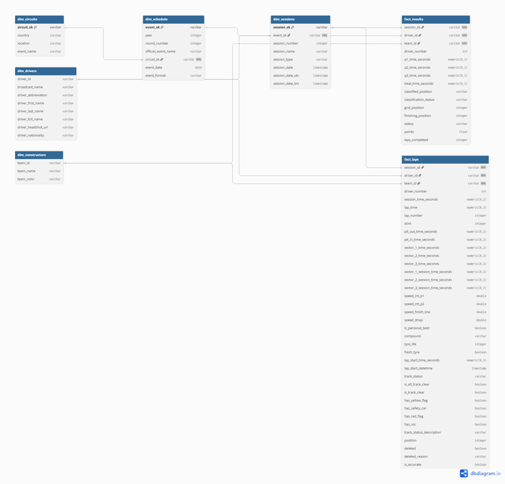

# 📊 Modelagem de Dados — Arquitetura Medalhão & Marts

Este documento descreve a arquitetura de dados, a modelagem dimensional (*Snowflake Schema*) e a camada analítica de serviço (*Website Marts*) implementada via **dbt** e **PostgreSQL (Supabase)** no **F1 Data Pipeline**.

---

## 🏛️ 1. Visão Geral da Arquitetura Medalhão

O pipeline estrutura os dados brutos extraídos dos resultados, da telemetria e das cronometragens da Fórmula 1 em camadas progressivas de qualidade, tipagem e enriquecimento:

```text
┌─────────────────┐       ┌─────────────────┐       ┌─────────────────┐       ┌─────────────────┐
│     BRONZE      │       │     SILVER      │       │      GOLD       │       │  WEBSITE MARTS  │
│ (Raw / Parquet) │  ───> │    (Staging)    │  ───> │   (Snowflake)   │  ───> │ (Serving Layer) │
│ S3 Lake/Tabelas │       │  dbt Staging /  │       │ Fatos & Dims /  │       │ Views e Tabelas │
│ Sem Tratamento  │       │ Limpeza & Tipos │       │ Surrogate Keys  │       │   Analíticas    │
└─────────────────┘       └─────────────────┘       └─────────────────┘       └─────────────────┘
```

| Camada | Schema | Materialização | Descrição |
| :--- | :--- | :--- | :--- |
| **Bronze** | `bronze` | Tabela / S3 Parquet | Dados brutos ingeridos diretamente do FastF1 em formato colunar Parquet e espelhados em tabelas raw. |
| **Silver** | `silver` | View / Staging | Limpeza, renomeação de colunas padronizadas, conversão de tipos de dados e desaninhamento de sessões. |
| **Gold** | `gold` | Tabela | Modelo dimensional Snowflake com tabelas de fatos e dimensões normalizadas, indexadas para alta performance analítica. |
| **Website**| `website` | View / Tabela | Modelos analíticos finais com regras de negócio, agregações cumulativas e métricas para o Dashboard. |

---

## ❄️ 2. Modelo Dimensional (Snowflake Schema)

A camada **Gold** implementa um esquema floco de neve (*Snowflake Schema*). Esse padrão foi escolhido para normalizar a hierarquia espacial e temporal dos finais de semana de Grande Prêmio, eliminando redundâncias de circuitos e calendários em cada sessão de pista:




---

## 🗄️ 3. Dicionário das Camadas

### 3.1 Camada Silver (Staging)

A camada Silver padroniza, limpa e enriquece os dados brutos da Bronze, garantindo tipagem consistente e tratando anomalias nos dados da Fórmula 1.

#### 🧹 Padrões Transversais de Sanitização (Macros dbt)
A extração via Python/Pandas a partir da biblioteca FastF1 gera artefatos clássicos de serialização que comprometeriam agregações e funções analíticas se não fossem tratados. Para assegurar qualidade e consistência em toda a camada Silver, foram implementadas macros modulares e reutilizáveis:
- **`clean_null_string`**: Converte strings vazias (`''`) e artefatos de texto gerados na exportação (`'nan'`, `'None'`, `'None None'`) em valores `NULL` reais do SQL.
- **`clean_null_time`**: Trata o valor sentinela `-9223372036854775808` (representação mínima de int64 para `pd.NaT` no Pandas) e tempos $\le 0$, convertendo-os em `NULL`.

#### 🏎️ `stg_results`
* **Origem**: `bronze.results` + Seed `driver_overrides`
* **Granularidade**: Um registro por piloto por sessão (Treino, Quali, Sprint ou Corrida).
* **Transformações e Regras de Negócio**:
  - **Tratamento de Overrides**: Cruzamento com o seed manual `driver_overrides` para corrigir divergências pontuais de nomes e IDs de pilotos.
  - **Normalização Textual**: Remoção de acentos e caracteres especiais (`TRANSLATE`) para buscas e agregações confiáveis.
  - **Resolução de IDs Nulos**: Inferência de `driver_id` e `team_id` ausentes através de Window Functions (`FIRST_VALUE`) particionadas pelo nome normalizado e ordenadas pelas temporadas mais recentes.
  - **Propagação de Metadados Recentes**: Padronização de fotos oficiais (`driver_headshot_url`), cores das equipes e nomes de transmissão para a versão mais recente cadastrada, mantendo consistência no histórico.
  - **Mapeamento de Status de Classificação**: Adição da coluna `classification_status`, que traduz os códigos da posição final (como 'R', 'D', 'W') para o seu significado descritivo (ex: 'Retired', 'Disqualified').
  - **Conversão de Tempos**: Conversão de tempos de qualificação e totais de nanossegundos para segundos decimais com 3 casas (`ROUND(time / 1e9, 3)`).

#### 📅 `stg_schedule`
* **Origem**: `bronze.schedule` + Seed `circuit_overrides`
* **Granularidade**: Um registro por evento/rodada de Grande Prêmio.
* **Transformações e Regras de Negócio**:
  - **Padronização Canônica de Circuitos**: Harmonização de nomes de países e cidades inconsistentes via seed `circuit_overrides`.
  - **Limpeza de Nomes Oficiais**: Remoção do ano no sufixo do nome do evento via Regex (`REGEXP_REPLACE(..., '\s+\d{4}$', '')`) e sanitização de strings nulas.
  - **Tratamento de Fuso Horário**: Conversão de datas e horas UTC para o horário de Brasília (`session_date_brt`) usando `AT TIME ZONE 'America/Sao_Paulo'`.

#### ⏱️ `stg_laps`
* **Origem**: `bronze.laps`
* **Granularidade**: Um registro por volta completada por piloto.
* **Transformações e Regras de Negócio**:
  - **Decodificação de Status de Pista (Otimização com CTEs)**: A decodificação de `TrackStatus` para `track_status_description` é pré-calculada via CTEs (`distinct_track_statuses` e `track_status_descriptions`) apenas para as combinações únicas distintas, reduzindo uma operação de 500.000 subqueries correlacionadas para um join em memória de menos de 1 segundo.
  - **Flags Analíticas de Neutralização**: Separação booleana para `has_yellow_flag`, `has_safety_car`, `has_vsc`, `has_red_flag` e `is_track_clear`.
  - **Conversão de Telemetria e Velocidades**: Tipagem de microssetores, tempos de parada nos boxes (`pit_in_time_seconds`, `pit_out_time_seconds`) e velocidades no radar (*Speed Trap*).

---

### 3.2 Camada Gold (Core - Modelo Snowflake)

A camada Gold implementa o modelo dimensional normalizado (*Snowflake Schema*), isolando entidades e gerando chaves substitutas (*surrogate keys*) determinísticas via hash MD5:

#### 🏛️ Dimensões
- **`dim_circuits`**: Entidade física do circuito com localização, país e nome do evento (`circuit_sk` gerado via hash MD5).
- **`dim_schedule`**: Calendário oficial de cada ano, contendo data oficial e formato do final de semana (`event_sk` gerado via hash MD5).
- **`dim_sessions`**: Normalização das 5 sessões de pista do GP (TL1, TL2, TL3, Quali, Sprint e Corrida) com chaves `session_sk` e relacionamento com `dim_schedule`.
- **`dim_drivers`**: Entidade de pilotos desduplicada, com identificador único `driver_id`, nomes completos, abreviação, nacionalidade e foto oficial.
- **`dim_constructors`**: Entidade de equipes desduplicada, com `team_id`, nome oficial e cor institucional em código hexadecimal.

#### 📈 Tabelas de Fatos
- **`fact_results`**:
  * **Granularidade**: Uma linha por piloto por sessão oficial.
  * **Métricas**: Posição final (`finishing_position`), grid de largada (`grid_position`), pontos conquistados, status de prova (Terminou, DNF, DSQ), voltas completadas e tempos de qualificação (Q1, Q2, Q3).
- **`fact_laps`**:
  * **Granularidade**: Uma linha por volta percorrida por piloto em cada sessão.
  * **Métricas & Telemetria**: Tempo de volta (`lap_time_seconds`), tempos dos setores 1, 2 e 3, velocidade máxima no radar (`speed_trap`), vida útil do pneu (`tyre_life`), composto (`compound`), stint de pit stop e indicadores de bandeira.

---

## 🌐 4. Camada de Consumo (Website Marts)

Os modelos em `transform/f1_dbt/models/marts/website` são otimizados especificamente para atender as páginas do Dashboard:

| Modelo | Tipo | Página de Consumo | Objetivo / Métricas |
| :--- | :--- | :--- | :--- |
| **`v_sessions_summary`** | Table | Visão Geral (`/`) & Corrida (`/race`) | Classificação da sessão com *gap* para o líder, *interval* para o carro à frente, deltas de posição e número de paradas. |
| **`v_season_races_summary`** | View | Visão Geral (`/`) | Listagem oficial dos Grandes Prêmios da temporada, status do evento (`Completed` / `Scheduled`), circuito, piloto vencedor e equipe. |
| **`v_driver_standings`** | View | Temporada (`/season`) | Classificação do mundial de pilotos com total de pontos, vitórias em GP/Sprint e pódios. |
| **`v_constructor_standings`** | View | Temporada (`/season`) | Classificação do mundial de construtores com pontos totais e vitórias acumuladas. |
| **`v_cumulative_drivers_points`** | View | Temporada (`/season`) | Pontuação acumulada corrida a corrida por piloto para alimentar o gráfico de linhas e o filtro de rodadas. |
| **`v_cumulative_teams_points`** | View | Temporada (`/season`) | Pontuação acumulada corrida a corrida por construtor para evolução no campeonato. |
| **`v_season_matrix`** | View | Temporada (`/season`) | Matriz de resultados da temporada estilo Wikipedia (P1, P2, P3, Pontos, Ret, DNS, DSQ) mapeando cada piloto a cada GP do calendário. |
| **`v_driver_season_summary`** | View | Pilotos (`/drivers` & `/drivers/[id]`) | Métricas consolidadas ano a ano por piloto: vitórias, poles, pódios, presenças em Q2/Q3, taxa de conversão pole-to-win, DNFs e posição final no campeonato. |
| **`v_driver_career_summary`** | View | Pilotos (`/drivers` & `/drivers/[id]`) | Estatísticas consolidadas da carreira histórica do piloto: GPs disputados, títulos mundiais, vitórias, pódios, status de piloto ativo no grid atual (`is_active`) e rankings históricos *all-time*. |
| **`v_constructor_season_summary`** | View | Equipes (`/teams` & `/teams/[id]`) | Métricas consolidadas ano a ano por construtora: vitórias GP/Sprint, poles, pódios, dobradinhas (1-2), primeiras filas no grid, pódios e pontos duplos, voltas mais rápidas, DNFs combinados, lineup de pilotos em JSON e posição no campeonato. |
| **`v_constructor_career_summary`** | View | Equipes (`/teams` & `/teams/[id]`) | Estatísticas consolidadas da trajetória histórica da equipe: total de GPs disputados, temporadas, títulos de construtores, vitórias, dobradinhas, primeiras filas, status de escuderia ativa (`is_active`) e rankings históricos *all-time*. |
| **`v_constructor_driver_summary`** | View | Equipes (`/teams/[id]`) | Estatísticas completas e comparativo histórico de cada piloto pela escuderia: temporadas ativas, lista de anos, títulos mundiais com o time, vitórias, poles, pódios, pontos e rankings internos na equipe. |
| **`v_ideal_lap`** | View | Telemetria (`/telemetry`) | Volta ideal (soma dos melhores micro-setores) vs. melhor volta real de cada piloto. |
| **`v_lap_by_lap`** | View | Corrida (`/race`) | Evolução de ritmo volta a volta por piloto. |
| **`v_race_pace`** | View | Corrida (`/race`) | Média e desvio padrão de ritmo de corrida por piloto/equipe sem voltas anômalas (Safety Car / Outlaps). |
| **`v_tyre_strategy`** | View | Corrida (`/race`) | Duração e degradação por composto (Soft, Medium, Hard, Intermediate, Wet). |
| **`v_max_speed`** | View | Telemetria (`/telemetry`) | Velocidades máximas registradas no radar (*Speed Trap*). |

---

## 🧮 5. Regras de Negócio & Window Functions

As views analíticas utilizam Window Functions avançadas particionadas por sessão (`session_sk`):

### 5.1 Gap para o Líder e Intervalo entre Carros (`v_sessions_summary`)
```sql
-- Diferença para o líder da corrida (P1)
final_session_time_seconds - FIRST_VALUE(final_session_time_seconds) OVER (
    PARTITION BY session_sk ORDER BY finishing_position ASC NULLS LAST
) AS gap_seconds,

-- Intervalo para o carro imediatamente à frente (P - 1)
ABS(final_session_time_seconds - LAG(final_session_time_seconds, 1) OVER (
    PARTITION BY session_sk ORDER BY finishing_position ASC NULLS LAST
)) AS interval_seconds
```

### 5.2 Delta de Posição de Largada vs. Chegada com Fallback de Grid (`v_sessions_summary`)
Para evitar deltas nulos ou inconsistentes decorrentes de omissões da API de telemetria em sessões de corrida/sprint, o grid de largada implementa fallback automático via `COALESCE` com o resultado da qualificação correspondente (`Qualifying` ou `Sprint Shootout`), sendo restrito estritamente a sessões competitivas de corrida:
```sql
CASE 
    WHEN dim_sessions.session_name IN ('Race', 'Sprint') THEN
        COALESCE(
            ranked_results.grid_position,
            CASE 
                WHEN dim_sessions.session_name = 'Sprint' THEN esg.sprint_grid_position
                ELSE eqg.quali_grid_position
            END
        ) - finishing_position
    ELSE NULL
END AS delta_position
```

### 5.3 Número de Pit Stops
```sql
-- Calculado pelo número máximo de stints do piloto menos um
MAX(stint) OVER(PARTITION BY session_sk, driver_id) - 1 AS stops
```

### 5.4 Pontuação Cumulativa ao Longo da Temporada
```sql
-- Soma acumulada corrida a corrida por ano e piloto
SUM(points) OVER (
    PARTITION BY year, driver_id 
    ORDER BY round_number, session_number
    ROWS BETWEEN UNBOUNDED PRECEDING AND CURRENT ROW
) AS cumulative_driver_points
```

### 5.5 Critério de Grid Ativo e Fallback de Temporada (`v_driver_career_summary`)
O catálogo e os perfis identificam os pilotos do **Grid Atual** com base na sua participação efetiva em sessões competitivas no ano (`Race`, `Sprint`, `Qualifying`, `Sprint Shootout`), excluindo pilotos de teste ou novatos que participam unicamente de treinos livres (FP1 regulamentar da FIA):
- **Cálculo de `competitive_gps`**: Contagem distinta de eventos com participação em sessões competitivas.
- **Fallback Automático de Virada de Temporada**: No início de uma nova temporada (onde ainda não ocorreram sessões competitivas), a view automaticamente faz fallback para o ano imediatamente anterior que possui corridas concluídas, impedindo que o grid zere no início do ano.

### 5.6 Taxa de Conversão de Pole Positions em Vitórias (*Pole-to-Win Rate*)
Métrica analítica que avalia a eficiência de conversão da pole position em vitória oficial:
```sql
ROUND((poles_to_win::NUMERIC / NULLIF(race_poles, 0)) * 100, 2) AS pole_to_win_rate
```

### 5.7 Métricas Coletivas de Equipe por Grande Prêmio (`v_constructor_season_summary`)
As métricas da escuderia são pré-calculadas evento a evento a partir dos resultados dos 2 carros da equipe para evitar duplicações em joins:
```sql
-- Dobradinha (1-2 no GP)
CASE WHEN COUNT(CASE WHEN results.finishing_position IN (1, 2) THEN 1 END) = 2 THEN 1 ELSE 0 END AS is_one_two,

-- Pódio Duplo (ambos no top 3)
CASE WHEN COUNT(CASE WHEN results.finishing_position <= 3 THEN 1 END) = 2 THEN 1 ELSE 0 END AS is_double_podium,

-- Pontuação Dupla (ambos na zona de pontos P1-P10)
CASE WHEN COUNT(CASE WHEN results.finishing_position <= 10 THEN 1 END) = 2 THEN 1 ELSE 0 END AS is_double_points,

-- Primeira Fila Completa (Bloqueio 1-2 no Grid de largada)
CASE WHEN COUNT(CASE WHEN results.grid_position IN (1, 2) THEN 1 END) = 2 THEN 1 ELSE 0 END AS is_front_row_lockout
```

### 5.8 Agregação da Dupla de Pilotos em JSON (`v_constructor_season_summary`)
Para alimentar simultaneamente as tabelas e os cards de Raio-X das equipes sem requisições adicionais, a relação de pilotos que atuaram pela escuderia no ano é consolidada em um array JSON com ordenação decrescente de pontos e corridas:
```sql
JSON_AGG(
    JSON_BUILD_OBJECT(
        'driver_id', drivers.driver_id,
        'driver_full_name', drivers.driver_full_name,
        'driver_abbreviation', drivers.driver_abbreviation,
        'driver_headshot_url', drivers.driver_headshot_url,
        'gps_raced', driver_totals.gps_raced,
        'points', driver_totals.points
    ) ORDER BY driver_totals.points DESC, driver_totals.gps_raced DESC
) AS drivers_lineup
```

### 5.9 Grid Ativo e Rankings Históricos de Construtores (`v_constructor_career_summary`)
Similarmente aos pilotos, o status de **Escuderia Ativa** (`is_active`) avalia a participação competitiva no ano corrente com fallback para a temporada anterior concluída. Os recordes históricos *all-time* são computados via `DENSE_RANK()`:
```sql
DENSE_RANK() OVER (ORDER BY total_world_championships DESC) AS rank_world_championships,
DENSE_RANK() OVER (ORDER BY race_wins DESC) AS rank_race_wins,
DENSE_RANK() OVER (ORDER BY race_poles DESC) AS rank_poles,
DENSE_RANK() OVER (ORDER BY race_podiums DESC) AS rank_race_podiums,
DENSE_RANK() OVER (ORDER BY total_points DESC) AS rank_points
```

### 5.10 Histórico e Rankings Internos de Pilotos por Equipe (`v_constructor_driver_summary`)
Para apresentar com fidelidade a passagem de cada piloto por uma escuderia específica (inclusive nos casos de saídas e retornos em anos não consecutivos), o modelo gera a lista cronológica exata de anos e calcula os rankings históricos restritos à equipe:
```sql
-- Lista cronológica de temporadas em que o piloto atuou pela equipe
STRING_AGG(DISTINCT schedule.year::TEXT, ', ' ORDER BY schedule.year::TEXT ASC) AS seasons_list,

-- Títulos mundiais de pilotos conquistados correndo por esta escuderia
COUNT(CASE WHEN driver_season_summary.championship_position = 1 AND driver_season_summary.is_season_completed THEN 1 END) AS driver_titles_with_team,

-- Rankings do piloto no histórico exclusivo da equipe
DENSE_RANK() OVER (PARTITION BY team_id ORDER BY total_points DESC, total_wins DESC) AS rank_in_team_points,
DENSE_RANK() OVER (PARTITION BY team_id ORDER BY race_wins DESC, total_points DESC) AS rank_in_team_wins,
DENSE_RANK() OVER (PARTITION BY team_id ORDER BY gps_raced DESC) AS rank_in_team_gps,
DENSE_RANK() OVER (PARTITION BY team_id ORDER BY driver_titles_with_team DESC, total_wins DESC) AS rank_in_team_titles
```

## ⚡ 6. Otimizações de Performance & Indexação

Para garantir tempos de resposta de consulta inferiores a **50 ms** no dashboard e prevenir timeouts durante a execução paralela de testes no dbt, as tabelas de fatos e os modelos analíticos pesados do mart são materializados como `table` com índices B-Tree criados via `post_hook`:

```sql
-- Índices na tabela v_sessions_summary
CREATE INDEX IF NOT EXISTS idx_sess_sum_lookup ON website.v_sessions_summary (year, round_number, session_name);
CREATE INDEX IF NOT EXISTS idx_sess_sum_finish ON website.v_sessions_summary (finishing_position);

-- Índices nas tabelas de métricas analíticas (Marts)
CREATE INDEX IF NOT EXISTS idx_race_pace_lookup ON website.v_race_pace (year, round_number);
CREATE INDEX IF NOT EXISTS idx_tyre_strat_lookup ON website.v_tyre_strategy (year, round_number);
CREATE INDEX IF NOT EXISTS idx_ideal_lap_lookup ON website.v_ideal_lap (year, round_number);
CREATE INDEX IF NOT EXISTS idx_max_speed_lookup ON website.v_max_speed (year, round_number);

-- Índices nas tabelas de fatos (Gold)
CREATE INDEX IF NOT EXISTS idx_fact_results_session_sk ON gold.fact_results (session_sk);
CREATE INDEX IF NOT EXISTS idx_fact_laps_session_sk ON gold.fact_laps (session_sk);
CREATE INDEX IF NOT EXISTS idx_fact_laps_session_lap_time ON gold.fact_laps (session_sk, lap_time_seconds) WHERE lap_time_seconds IS NOT NULL;
CREATE INDEX IF NOT EXISTS idx_fact_laps_speed_trap ON gold.fact_laps (session_sk, speed_trap) WHERE speed_trap IS NOT NULL;
```

---

## 🧪 7. Qualidade de Dados & Testes dbt

Os dados são auditados automaticamente na execução do dbt por meio das suítes de testes definidas nos arquivos de esquema:
- [`staging/_staging_models.yml`](../transform/f1_dbt/models/staging/_staging_models.yml): Testes de validação da camada Silver / Staging.
- [`marts/core/_core_models.yml`](../transform/f1_dbt/models/marts/core/_core_models.yml): Testes de unicidade e integridade referencial do modelo dimensional Snowflake.
- [`marts/website/_website_models.yml`](../transform/f1_dbt/models/marts/website/_website_models.yml): Testes e documentação das visões analíticas de consumo do dashboard.

### Tipos de Testes Aplicados:
- **Unicidade (`unique` & `unique_combination_of_columns`)**: Garante ausência de duplicação em chaves primárias e substitutas (`session_sk`, `driver_id`, `event_sk`), bem como combinações exclusivas de sessão, piloto e volta.
- **Valores Aceitos (`accepted_values`)**: Validação de domínios restritos, incluindo compostos modernos e históricos (`'SOFT'`, `'MEDIUM'`, `'HARD'`, `'INTERMEDIATE'`, `'WET'`, `'SUPERSOFT'`, `'ULTRASOFT'`, `'HYPERSOFT'`, `'TEST'`).
- **Valores Obrigatórios (`not_null`)**: Assegura preenchimento de campos críticos de pontuação, nomes, identificadores e métricas de volta, com tolerância deliberada em colunas esparsas de temporadas anteriores (`official_event_name`, datas locais de sessões).
- **Integridade Referencial (`relationships`)**: Valida que toda chave estrangeira nas tabelas de fatos existe na respectiva dimensão (`dim_sessions`, `dim_drivers`, `dim_constructors`, `dim_circuits`).
- **Testes de Aceitação Customizados**: Validações de limites e regras de negócio (ex: consistência de intervalos de tempo e posições).
