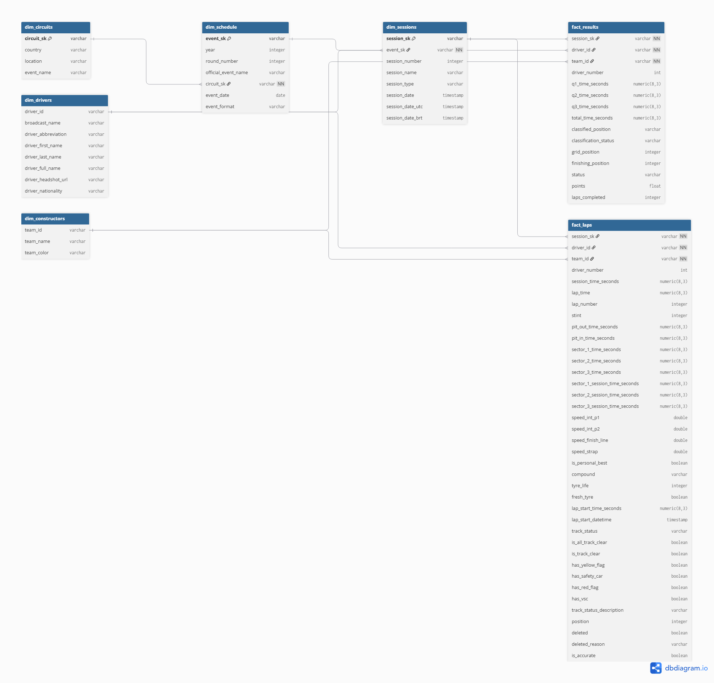

# 📊 Modelagem de Dados — Arquitetura Medalhão & Marts

Este documento descreve a arquitetura de dados, a modelagem dimensional (*Snowflake Schema*), as regras de negócio históricas da FIA e a camada de serviço (*Serving Layer*) implementada via **dbt**, **Google BigQuery** e **PostgreSQL (Supabase)** no **F1 Data Pipeline**.

---

## 🏛️ 1. Visão Geral da Arquitetura Medalhão & Serving Layer

O pipeline estrutura os dados brutos extraídos dos resultados, da telemetria e das cronometragens da Fórmula 1 em camadas progressivas dentro do **Google BigQuery (Data Warehouse)** e sincroniza os modelos analíticos finais para tabelas físicas indexadas no **Supabase PostgreSQL (Serving Layer)**:

```text
┌─────────────────┐     ┌─────────────────┐     ┌─────────────────┐     ┌─────────────────┐     ┌─────────────────┐
│     BRONZE      │     │     SILVER      │     │      GOLD       │     │      MARTS      │     │  SERVING LAYER  │
│ (GCS + BigQuery)│ ──> │   (BigQuery)    │ ──> │   (BigQuery)    │ ──> │   (BigQuery)    │ ──> │   (Supabase)    │
│ Parquet & Raw   │     │  dbt Staging /  │     │ Fatos & Dims /  │     │ Views Analíticas│     │ Tabelas Físicas │
│ Sem Tratamento  │     │ Limpeza & Tipos │     │ Snowflake Schema│     │   (website.v_*) │     │ Indexadas B-Tree│
└─────────────────┘     └─────────────────┘     └─────────────────┘     └─────────────────┘     └─────────────────┘
```

| Camada | Ambiente | Schema / Dataset | Materialização | Descrição |
| :--- | :--- | :--- | :--- | :--- |
| **Data Lake** | Google Cloud Storage | `f1-lake-storage` | Arquivos `.parquet` | Armazenamento imutável colunar particionado por ano, GP e sessão. |
| **Bronze** | Google BigQuery | `bronze` | Tabela Nativa | Dados brutos carregados a partir dos Parquets do GCS (`schedule`, `results`, `laps`). |
| **Silver** | Google BigQuery | `silver` | View (`dbt`) | Limpeza, renomeação padronizada, conversão de tipos, tratamento de fusos horários e desaninhamento. |
| **Gold** | Google BigQuery | `gold` | Tabela (`dbt`) | Modelo dimensional *Snowflake* com tabelas de fatos e dimensões clusterizadas e chaves substitutas. |
| **Marts** | Google BigQuery | `website` | View (`dbt`) | Modelos analíticos finais com regras históricas da FIA, agregações cumulativas e métricas do domínio. |
| **Serving Layer** | Supabase (PostgreSQL) | `website` | Tabela Indexada | Espelhamento incremental dos *Marts* em tabelas relacionais físicas com índices B-Tree para leitura em milissegundos. |

---

## ❄️ 2. Modelo Dimensional (Snowflake Schema)

A camada **Gold** implementa um esquema floco de neve (*Snowflake Schema*). Esse padrão foi escolhido para normalizar a hierarquia espacial e temporal dos finais de semana de Grande Prêmio, eliminando redundâncias de circuitos e calendários em cada sessão de pista:



---

## 🗄️ 3. Dicionário das Camadas

### 3.1 Camada Silver (Staging — BigQuery)

A camada Silver padroniza, limpa e enriquece os dados brutos da Bronze, garantindo tipagem consistente e tratando anomalias históricas nos dados da Fórmula 1.

#### 🧹 Padrões Transversais de Sanitização (Macros dbt)
A extração via Python/Pandas a partir da biblioteca FastF1 gera artefatos de serialização que comprometeriam agregações se não fossem tratados. Para assegurar qualidade e consistência em toda a camada Silver, foram implementadas macros reutilizáveis:
- **`clean_null_string`**: Converte strings vazias (`''`) e artefatos de texto gerados na exportação (`'nan'`, `'None'`, `'None None'`) em valores `NULL` reais do SQL.
- **`clean_null_time`**: Trata o valor sentinela `-9223372036854775808` (representação mínima de `int64` para `pd.NaT` no Pandas) e tempos $\le 0$, convertendo-os em `NULL`.

#### 🏎️ `stg_results`
* **Origem**: `bronze.results` + Seed `driver_overrides`
* **Granularidade**: Um registro por piloto por sessão (Treino, Quali, Sprint ou Corrida).
* **Transformações e Regras de Negócio**:
  - **Tratamento de Overrides**: Cruzamento com o seed `driver_overrides` para corrigir divergências pontuais de nomes e IDs de pilotos.
  - **Normalização Textual**: Remoção de acentos e caracteres especiais (`TRANSLATE`) para buscas e agregações confiáveis.
  - **Resolução de IDs Nulos**: Inferência de `driver_id` e `team_id` ausentes através de Window Functions (`FIRST_VALUE`) particionadas pelo nome normalizado e ordenadas pelas temporadas mais recentes.
  - **Propagação de Metadados Recentes**: Padronização de fotos oficiais (`driver_headshot_url`), cores das equipes e nomes de transmissão para a versão mais recente cadastrada.
  - **Mapeamento de Status de Classificação**: Adição da coluna `classification_status`, que traduz os códigos da posição final (`'R'`, `'D'`, `'W'`) para seu significado descritivo (`'Retired'`, `'Disqualified'`, `'Withdrawn'`).
  - **Conversão de Tempos**: Conversão de tempos de qualificação e totais de nanossegundos para segundos decimais com 3 casas (`ROUND(time / 1e9, 3)`).

#### 📅 `stg_schedule`
* **Origem**: `bronze.schedule` + Seeds `circuit_mapping` e `seed_circuits`
* **Granularidade**: Um registro por evento/rodada de Grande Prêmio.
* **Transformações e Regras de Negócio**:
  - **Mapeamento e Padronização Canônica de Circuitos**: Desacoplamento entre evento de calendário e autódromo físico. Através do seed `circuit_mapping`, cada par `(raw_country, raw_location)` inconsistente do FastF1 é mapeado para um `circuit_id` canônico, enriquecido com os metadados oficiais do `seed_circuits` (nome do autódromo, país, cidade e tipo de traçado).
  - **Limpeza de Nomes Oficiais**: Remoção do ano no sufixo do nome do evento via Regex (`REGEXP_REPLACE(..., r'\s+\d{4}$', '')`).
  - **Tratamento de Fuso Horário**: Conversão de timestamps UTC para o horário de Brasília (`session_date_brt`) no BigQuery.

#### ⏱️ `stg_laps`
* **Origem**: `bronze.laps`
* **Granularidade**: Um registro por volta completada por piloto.
* **Transformações e Regras de Negócio**:
  - **Decodificação de Status de Pista (Otimização com CTEs)**: A decodificação de `TrackStatus` para `track_status_description` é pré-calculada via CTEs apenas para as combinações únicas distintas, reduzindo uma operação de centenas de milhares de subqueries correlacionadas para um join leve.
  - **Flags Analíticas de Neutralização**: Separação booleana para `has_yellow_flag`, `has_safety_car`, `has_vsc`, `has_red_flag` e `is_track_clear`.
  - **Conversão de Telemetria e Velocidades**: Tipagem de microssetores, tempos de parada nos boxes (`pit_in_time_seconds`, `pit_out_time_seconds`) e velocidades no radar (*Speed Trap*).

---

### 3.2 Camada Gold (Core — Modelo Snowflake no BigQuery)

A camada Gold implementa o modelo dimensional normalizado (*Snowflake Schema*), isolando entidades e gerando chaves substitutas (*surrogate keys*) determinísticas via `dbt_utils.generate_surrogate_key`:

#### 🏛️ Dimensões
- **`dim_circuits`**: Entidade canônica do autódromo físico oficial da Fórmula 1 (gerada a partir de `seed_circuits`), contendo a chave primária slug `circuit_id` (ex: `silverstone`, `interlagos`), nome oficial do autódromo (`circuit_name`), país (`country`), cidade/região (`location`) e tipo de pista (`track_type`: Permanente, Rua ou Misto).
- **`dim_schedule`**: Calendário oficial de cada ano, contendo data oficial, formato do final de semana e chave estrangeira direta para o autódromo físico (`circuit_id`), com identificador `event_sk`.
- **`dim_sessions`**: Normalização das 5 sessões de pista do GP (TL1, TL2, TL3, Quali, Sprint e Corrida) com chaves `session_sk` e relacionamento com `dim_schedule`.
- **`dim_drivers`**: Entidade de pilotos desduplicada, com identificador único `driver_id`, nomes completos, abreviação, nacionalidade e foto oficial.
- **`dim_constructors`**: Entidade de equipes desduplicada, com `team_id`, nome oficial e cor institucional em código hexadecimal.

#### 📈 Tabelas de Fatos
- **`fact_results`** *(Clusterizada por `session_sk, driver_id`)*:
  * **Granularidade**: Uma linha por piloto por sessão oficial.
  * **Métricas**: Posição final (`finishing_position`), grid de largada (`grid_position`), pontos conquistados, status de prova (Terminou, DNF, DSQ), voltas completadas e tempos de qualificação (Q1, Q2, Q3).
- **`fact_laps`** *(Clusterizada por `session_sk, driver_id`)*:
  * **Granularidade**: Uma linha por volta percorrida por piloto em cada sessão.
  * **Métricas & Telemetria**: Tempo de volta (`lap_time_seconds`), tempos dos setores 1, 2 e 3, velocidade máxima no radar (`speed_trap`), vida útil do pneu (`tyre_life`), composto (`compound`), stint de pit stop e indicadores de bandeira.

---

## 🌐 4. Camada de Consumo (Website Marts)

Os modelos em `transform/f1_dbt/models/marts/website` são compilados como `view` no BigQuery e sincronizados como **tabelas físicas indexadas** no Supabase PostgreSQL:

| Modelo | Estratégia Sync | Página de Consumo | Objetivo / Métricas |
| :--- | :--- | :--- | :--- |
| **`v_sessions_summary`** | `incremental_year` | Visão Geral (`/`) & Corrida (`/race`) | Classificação da sessão com *gap* para o líder, *interval* para o carro à frente, deltas de posição e número de paradas. |
| **`v_circuit_season_summary`** | `incremental_year` | Temporada (`/season`) & Circuitos (`/circuits`) | Resumo dos Grandes Prêmios da temporada: status do evento (`Completed`, `In Progress`, `Scheduled`), circuito, pole position, vencedor da corrida/sprint, volta mais rápida e abandonos (DNFs). |
| **`v_driver_standings`** | `incremental_year` | Temporada (`/season`) | Classificação oficial do mundial de pilotos com total de pontos, vitórias em GP/Sprint e pódios. |
| **`v_constructor_standings`** | `incremental_year` | Temporada (`/season`) | Classificação oficial do mundial de construtores com pontos totais e vitórias acumuladas. |
| **`v_cumulative_drivers_points`** | `incremental_year` | Temporada (`/season`) | Pontuação acumulada corrida a corrida por piloto para alimentar o gráfico de evolução e filtro de rodadas. |
| **`v_cumulative_teams_points`** | `incremental_year` | Temporada (`/season`) | Pontuação acumulada corrida a corrida por construtor para evolução no campeonato. |
| **`v_season_matrix`** | `incremental_year` | Temporada (`/season`) | Matriz de resultados da temporada estilo Wikipedia (P1, P2, P3, Pontos, Ret, DNS, DSQ) mapeando cada piloto a cada GP do calendário. |
| **`v_driver_season_summary`** | `incremental_year` | Pilotos (`/drivers` & `/drivers/[id]`) | Métricas consolidadas ano a ano por piloto: vitórias, poles, pódios, presenças em Q2/Q3, taxa de conversão pole-to-win, DNFs e posição final no campeonato. |
| **`v_driver_career_summary`** | `full_replace` | Pilotos (`/drivers` & `/drivers/[id]`) | Estatísticas consolidadas da carreira histórica do piloto: GPs disputados, títulos mundiais oficiais, vitórias, pódios, status de piloto ativo (`is_active`) e rankings históricos *all-time*. |
| **`v_circuit_driver_performance`** | `full_replace` | Pilotos (`/drivers/[id]`) & Circuitos | Histórico detalhado de performance do piloto em cada autódromo físico: participações, vitórias, pódios, poles, voltas mais rápidas, pontos totais, melhor posição e abandonos (DNFs). |
| **`v_circuit_overview`** | `full_replace` | Circuitos (`/circuits` & `/circuits/[id]`) | Panorama histórico completo de cada autódromo: total de GPs, anos ativo, média e total de DNFs, equipe mais vitoriosa, pilotos recordistas e recordes oficiais de volta em corrida e classificação. |
| **`v_constructor_season_summary`** | `incremental_year` | Equipes (`/teams` & `/teams/[id]`) | Métricas consolidadas ano a ano por construtora: vitórias GP/Sprint, poles, pódios, dobradinhas (1-2), primeiras filas, pódios e pontos duplos, voltas mais rápidas, DNFs combinados, lineup em JSON e posição no campeonato. |
| **`v_constructor_career_summary`** | `full_replace` | Equipes (`/teams` & `/teams/[id]`) | Estatísticas consolidadas da trajetória histórica da equipe: total de GPs disputados, temporadas, títulos mundiais de construtores, vitórias, dobradinhas, primeiras filas, status ativo (`is_active`) e rankings *all-time*. |
| **`v_constructor_driver_summary`** | `full_replace` | Equipes (`/teams/[id]`) | Estatísticas completas e comparativo histórico de cada piloto pela escuderia: temporadas ativas, lista de anos, títulos mundiais conquistados com o time, vitórias, poles, pódios, pontos e rankings internos. |
| **`v_ideal_lap`** | `incremental_year` | Telemetria (`/telemetry`) | Volta ideal (soma dos melhores micro-setores) vs. melhor volta real de cada piloto. |
| **`v_lap_by_lap`** | `incremental_year` | Corrida (`/race`) | Evolução de ritmo volta a volta por piloto. |
| **`v_race_pace`** | `incremental_year` | Corrida (`/race`) | Média e desvio padrão de ritmo de corrida por piloto/equipe sem voltas anômalas (Safety Car / Outlaps). |
| **`v_tyre_strategy`** | `incremental_year` | Corrida (`/race`) | Duração e degradação por composto (`Soft`, `Medium`, `Hard`, `Intermediate`, `Wet`). |
| **`v_max_speed`** | `incremental_year` | Telemetria (`/telemetry`) | Velocidades máximas registradas no radar (*Speed Trap*). |

---

## 🧮 5. Regras de Negócio & Window Functions

As views analíticas utilizam Window Functions avançadas no BigQuery:

### 5.1 Cálculo Analítico de Títulos Mundiais e Regras Históricas da FIA
Ao longo de mais de 75 anos de Fórmula 1, o regulamento de pontuação da FIA sofreu diversas alterações estruturais. Somar de forma ingênua todos os pontos produziria campeões incorretos em temporadas históricas.

Os modelos [`v_constructor_season_summary`](../transform/f1_dbt/models/marts/website/v_constructor_season_summary.sql), [`v_constructor_career_summary`](../transform/f1_dbt/models/marts/website/v_constructor_career_summary.sql), [`v_driver_season_summary`](../transform/f1_dbt/models/marts/website/v_driver_season_summary.sql), [`v_driver_standings`](../transform/f1_dbt/models/marts/website/v_driver_standings.sql), [`v_constructor_standings`](../transform/f1_dbt/models/marts/website/v_constructor_standings.sql) e [`v_season_matrix`](../transform/f1_dbt/models/marts/website/v_season_matrix.sql) implementam diretamente as regras regulamentares da FIA sobre os dados de `fact_results`:

1. **Criação do Campeonato Mundial de Construtores em 1958 (`year >= 1958`)**:
   - Entre 1950 e 1957 existia apenas o Campeonato Mundial de Pilotos. Portanto, títulos de construtores são contabilizados exclusivamente a partir da temporada de **1958**:
     ```sql
     COUNT(CASE WHEN year >= 1958 AND championship_position = 1 AND is_season_completed THEN 1 END) AS total_world_championships
     ```
2. **Regra do Melhor Carro por Corrida nos Construtores (`1958–1978`)**:
   - De 1958 a 1978, apenas o carro mais bem colocado de cada construtor em cada corrida marcava pontos para o Mundial de Construtores (`MAX(COALESCE(results.points, 0))` por sessão/equipe). A partir de 1979, todos os carros da equipe passaram a somar pontos.
3. **Sistema Histórico de Descartes (*Dropped Scores*, `1950–1990`)**:
   - Nos anos em que o regulamento computava apenas os $N$ melhores resultados da temporada (ex: 4 melhores entre `1950–1953`; 5 melhores em `1954–1957, 1959, 1961–1962, 1966`; 6 melhores em `1958, 1960, 1963–1965`; e 11 melhores entre `1981–1990`), os resultados de cada piloto/equipe são ranqueados via `ROW_NUMBER() OVER (PARTITION BY year, id ORDER BY points DESC)` para apurar os pontos líquidos válidos que definem a posição oficial no campeonato (`championship_position`).
4. **Exclusões e Desclassificações Oficiais da FIA**:
   - **Construtores 2007**: A McLaren foi oficialmente excluída do Campeonato de Construtores pela FIA (*Spygate*), conferindo o título de 2007 à Ferrari.
   - **Pilotos 1997**: Michael Schumacher foi desclassificado da classificação final do Campeonato de Pilotos de 1997 pela FIA.

### 5.2 Gap para o Líder e Intervalo entre Carros (`v_sessions_summary`)
```sql
-- Diferença para o líder da corrida (P1)
final_session_time_seconds - FIRST_VALUE(final_session_time_seconds) OVER (
    PARTITION BY session_sk ORDER BY finishing_position ASC NULLS LAST
) AS gap_seconds,

-- Intervalo para o carro imediatamente à frente (P - 1)
ABS(final_session_time_seconds - LAG(final_session_time_seconds, 1) OVER (
    PARTITION BY session_sk ORDER BY finishing_position ASC NULLS LAST
)) AS interval_seconds
```

### 5.3 Delta de Posição de Largada vs. Chegada com Fallback de Grid (`v_sessions_summary`)
Para evitar deltas nulos decorrentes de omissões da API em sessões de corrida/sprint, o grid de largada implementa fallback automático via `COALESCE` com o resultado da qualificação correspondente (`Qualifying` ou `Sprint Shootout`):
```sql
CASE 
    WHEN dim_sessions.session_name IN ('Race', 'Sprint') THEN
        COALESCE(
            ranked_results.grid_position,
            CASE 
                WHEN dim_sessions.session_name = 'Sprint' THEN esg.sprint_grid_position
                ELSE eqg.quali_grid_position
            END
        ) - finishing_position
    ELSE NULL
END AS delta_position
```

### 5.4 Número de Pit Stops e Pontuação Cumulativa
```sql
-- Pit stops: calculado pelo número máximo de stints do piloto menos um
MAX(stint) OVER (PARTITION BY session_sk, driver_id) - 1 AS stops

-- Pontuação cumulativa corrida a corrida por ano e piloto
SUM(points) OVER (
    PARTITION BY year, driver_id 
    ORDER BY round_number, session_number
    ROWS BETWEEN UNBOUNDED PRECEDING AND CURRENT ROW
) AS cumulative_driver_points
```

### 5.5 Critério de Grid Ativo e Fallback de Temporada (`v_driver_career_summary` & `v_constructor_career_summary`)
O catálogo e os perfis identificam os pilotos e equipes do **Grid Atual** (`is_active`) com base na participação efetiva em sessões competitivas no ano (`Race`, `Sprint`, `Qualifying`, `Sprint Shootout`), excluindo pilotos de teste que participam unicamente de treinos livres (FP1). No início de uma nova temporada (antes da primeira sessão competitiva), a view faz fallback automático para a última temporada com corridas concluídas.

### 5.6 Métricas Coletivas de Equipe e Lineup em JSON (`v_constructor_season_summary`)
As métricas coletivas da escuderia são pré-calculadas corrida a corrida (dobradinhas `1-2`, pódios duplos, pontuação dupla e bloqueios da primeira fila `1-2` no grid), e a relação de pilotos que atuaram pela equipe no ano é consolidada em uma string JSON ordenada por pontos e corridas:
```sql
TO_JSON_STRING(ARRAY_AGG(
    STRUCT(
        drivers.driver_id,
        drivers.driver_full_name,
        drivers.driver_abbreviation,
        drivers.driver_headshot_url,
        driver_totals.gps_raced,
        driver_totals.points
    ) ORDER BY driver_totals.points DESC, driver_totals.gps_raced DESC
)) AS drivers_lineup
```

### 5.7 Resolução de Recordistas e Recordes de Volta por Autódromo (`v_circuit_overview`)
Para determinar os pilotos e equipes recordistas em cada circuito e separar tecnicamente o **Recorde de Volta em Corrida** (`session_name = 'Race'`) do **Recorde de Classificação** (`session_name IN ('Qualifying', 'Sprint Shootout', 'Sprint Qualifying')`), a view utiliza cláusulas `QUALIFY ROW_NUMBER() OVER (...) = 1` nativas do BigQuery, priorizando em caso de empate o registro mais recente (`last_year DESC`).

---

## ⚡ 6. Otimizações de Performance: Clusterização no BigQuery & Indexação na Serving Layer

1. **Clusterização no BigQuery (`Gold`)**:
   - As tabelas de fatos (`fact_results` e `fact_laps`) são materializadas com `cluster_by=['session_sk', 'driver_id']`, reduzindo drasticamente o custo de varredura e acelerando os agregadores históricos das views `website.v_*`.
2. **Tabelas Físicas e Índices B-Tree Automáticos no PostgreSQL (`Serving Layer`)**:
   - Durante a execução do [`sync_serving_layer.py`](../ingestion/sync_serving_layer.py), as views do BigQuery são persistidas como tabelas físicas no schema `website` do Supabase.
   - A função `infer_indexes()` inspeciona dinamicamente as colunas de cada tabela sincronizada e cria automaticamente índices compostos B-Tree (como `(year, round_number, session_name)`, `(year, driver_id)`, `(year, team_id)`, `(circuit_id)`), garantindo tempos de resposta abaixo de **20 ms** nas consultas do Web App Next.js.

---

## 🧪 7. Qualidade de Dados & Testes dbt

Os dados são auditados automaticamente a cada execução do `dbt build` por meio de **222 testes de dados** definidos nos arquivos YAML:
- [`staging/_staging_models.yml`](../transform/f1_dbt/models/staging/_staging_models.yml): Testes de validação da camada Silver / Staging.
- [`marts/core/_core_models.yml`](../transform/f1_dbt/models/marts/core/_core_models.yml): Testes de unicidade e integridade referencial do modelo dimensional Snowflake.
- [`marts/website/_website_models.yml`](../transform/f1_dbt/models/marts/website/_website_models.yml): Testes e documentação completa de todas as colunas das visões analíticas da camada `website`.

### Categorias de Testes:
- **Unicidade (`unique` & `unique_combination_of_columns`)**: Garante ausência de duplicação em chaves substitutas (`session_sk`, `driver_id`, `event_sk`) e chaves compostas.
- **Valores Aceitos (`accepted_values`)**: Validação de domínios restritos (como compostos de pneus modernos e históricos).
- **Não Nulidade (`not_null`)**: Assegura preenchimento de identificadores, posições, nomes e métricas essenciais.
- **Integridade Referencial (`relationships`)**: Valida que toda chave estrangeira nas tabelas de fatos existe na respectiva dimensão (`dim_sessions`, `dim_drivers`, `dim_constructors`, `dim_circuits`).
